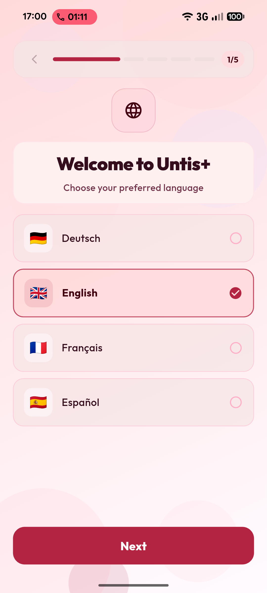
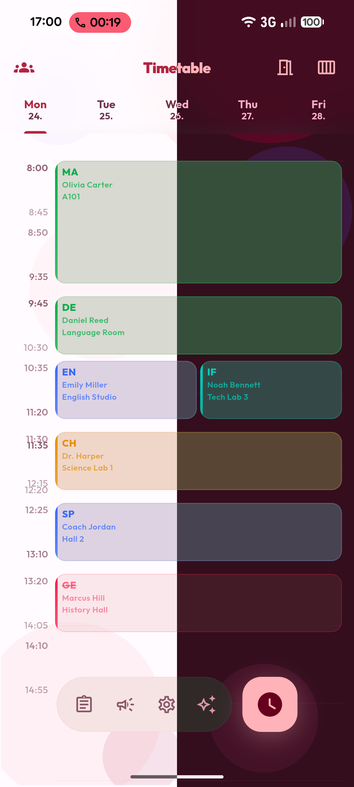
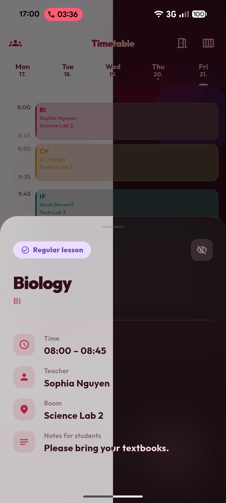
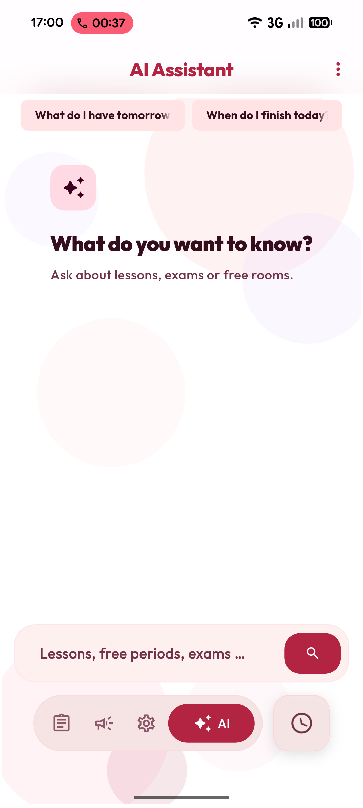
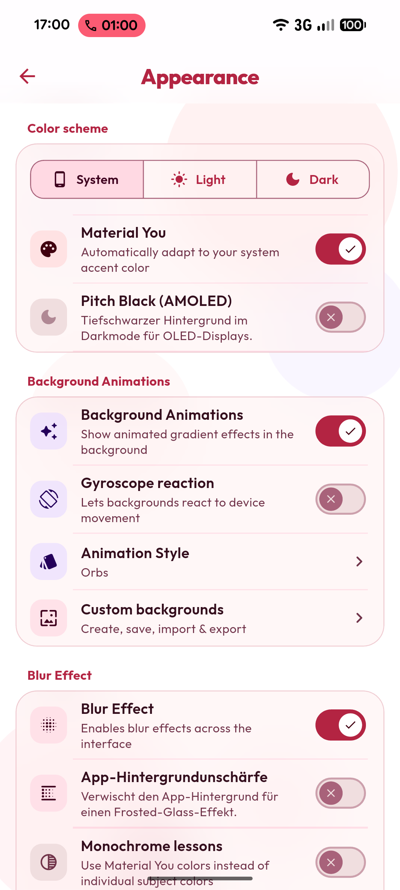
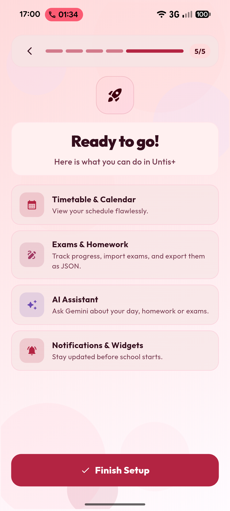

# UntisPlus

<p align="center">
  
</p>

<p align="center">
  <strong>A sleek, privacy-first companion app for WebUntis.</strong>
</p>

<p align="center">
  
  
  
  
</p>

---

## Overview

UntisPlus is a modern, secure, and intuitive Flutter client for students and teachers to manage school schedules, tasks, and communications. Built with privacy as the default: all authentication details, credentials, and schedule data stay strictly on your local device — nothing is ever shared with central servers.

| Aspect | Specification |
| :--- | :--- |
| **Data Policy** | Private by default. Credentials and schedule data never leave your device. (Zero cloud data sharing when using Local AI)|
| **Current Version** | `5.7.0` |
| **Target Platforms** | Android, iOS |
| **Languages** | English, Deutsch, Español, Français |

---

## Features

* **Expressive & Adaptive Timetable** — Fluid daily and weekly views featuring the modern Material 3 Expressive design, live wave progress indicator, gesture navigation, and clear badges for substitutions and cancellations.
* **Absences & Change Center** — Offline-first absence management and a unified, deduplicated timeline for teacher, room, subject changes, and cancellations.
* **Exam & Homework Tracker** — Consolidated overview of upcoming exams, homework deadlines, lesson notes, and direct school broadcast announcements.
* **Privacy-First AI Copilot** — Run local AI models directly on your device (via fllama / GGUF) with zero cloud data transmission, or connect your own API keys / custom endpoints (OpenAI, Gemini, Claude, Ollama, DeepSeek).
* **Multi-Account by Design** — Seamlessly manage multiple student or teacher profiles with isolated credentials, caches, alarms, and widgets.
* **Custom Home Screen Widgets** — Interactive widget editor with real-time preview, customizable themes, and quick status overviews for Android and iOS.
* **Smart Room Finder** — Fast vacant classroom search with live period availability.
* **Personalized & Accessible** — Multiple visual themes (Default, Manga, Glass, Cyber), dynamic Material You coloring, AMOLED dark mode, and high-contrast accessibility support.

---

## Screenshots

| Welcome | Timetable | Lesson Details |
| :---: | :---: | :---: |
|  |  |  |

| AI Assistant | Appearance | Ready to Go |
| :---: | :---: | :---: |
|  |  |  |

---

## Roadmap

| Feature / Goal | Status |
| :--- | :---: |
| Material 3 Expressive UI redesign | Completed |
| On-device local LLM copilot | Completed |
| Offline-first structured cache foundation | Completed |
| Absence overview and timetable change center | Completed |
| Full 4-locale localization (EN, DE, ES, FR) | Completed |
| Custom home screen widget editor | Completed |
| Feature-by-feature Riverpod migration | In progress |

---

## Tech Stack & Key Dependencies

| Dependency | Purpose |
| :--- | :--- |
| **`http`** & **`dio`** | WebUntis API communication and network transfers |
| **`fllama`** | On-device LLM inference runtime for private local AI |
| **`flutter_secure_storage`** | Native encrypted keystore/keychain storage for credentials and tokens |
| **`cryptography`** | Client-side cryptographic primitives and secure hashing |
| **`shared_preferences`** | User preferences such as theme, language, and layout options |
| **`hive_ce_flutter`** | Fast, versioned, account-scoped offline cache |
| **`flutter_riverpod`** | Reactive state management and dependency injection |
| **`dynamic_color`** | Material You dynamic theme integration |
| **`home_widget`** | Native Android and iOS home screen widgets |
| **`flutter_local_notifications`** | Time-critical lesson alerts, change notifications, and reminders |

---

## Project Structure

```
.
├── assets/                    # Graphic elements and app icons
├── lib/
│   ├── app/                   # Central application routing configuration
│   ├── core/                  # State engines, themes, and time utilities
│   ├── data/                  # Secure storage, cache, and WebUntis transport
│   ├── features/              # Typed feature data/domain modules
│   ├── screens/               # System views, settings hub, and setup guides
│   ├── services/              # Notification, background sync, and backup engines
│   ├── web/                   # Web-specific platform adaptions
│   └── widgets/               # Reusable UI elements and background filters
└── pubspec.yaml               # Package definitions and metadata
```

---

## Development Setup

### System Prerequisites

Ensure the Flutter SDK is installed and configured in your environment variable path.

### Execution

```bash
# Clone the codebase
git clone https://github.com/ninocss/untisplus.git

# Navigate into the project folder
cd untisplus

# Resolve project dependencies
flutter pub get

# Launch the application in debug mode
flutter run
```

Pure Dart and widget tests can be run without compiling the optional local-AI
runtime. The wrapper temporarily substitutes a test-only fllama stub and always
restores the production dependency afterwards:

```powershell
pwsh -File tool/test_without_local_ai.ps1
```

### Development Server

Please visit this Repo:
https://github.com/OseMine/UntisPlus-dev-server

---
## Installation
### Android
1. [Download](https://github.com/ninocss/untisplus/releases) the latest APK from Releases
2. Install APK

### iOS
1. Install AltStore Classic Using [Altserver](https://faq.altstore.io/altstore-classic) or [AltStore PAL (EU Only)](https://faq.altstore.io/altstore-pal).
2. Add UntisPlus Source to AltStore
```bash
https://raw.githubusercontent.com/ninocss/untisplus/refs/heads/main/altstore/source.json
```
3. Install and Sign using Apple ID(Signing has to be renewt every 7 days when using a non Developer AppleID)

<p align="center">
  <a href="https://altstore.io/source/raw.githubusercontent.com/ninocss/untisplus/refs/heads/main/altstore/source.json?app=com.ninocss.untisplus">
    
  </a>
</p>

### iOS (TrollStore)
TrollStore installs Untis+ permanently — no Apple ID and no 7-day re-signing.
> [!WARNING]
> This version and installation method are not actively maintained, as TrollStore is no longer supported on iOS 17+.

> Compatibility: TrollStore relies on the CoreTrust bug and works on **iOS 14.0 – 17.0** on supported devices (not iOS 17.0.1+ or newer). It is **not** a jailbreak. See [ios.cfw.guide](https://ios.cfw.guide/installing-trollstore) for device compatibility and installation of TrollStore itself.

1. [Install TrollStore](https://ios.cfw.guide/installing-trollstore) on your device.
2. Download the **TrollStore IPA** (`UntisPlus-v5.3.3-trollstore.ipa`) and nightly TrollStore builds from the [Releases](https://github.com/ninocss/untisplus/releases) page.
3. Tap the downloaded file (visible in the Files app / your Downloads browser).
4. Choose **Open with TrollStore**, then tap **Install**.
5. Untis+ is now perma-signed; no signing renewal is ever needed.

The TrollStore build is fake-signed with embedded entitlements (app groups, push) so home screen widgets, shared containers and notifications keep working. If apps stop launching after an OS update/reboot, re-select a **Persistence Helper** in TrollStore settings.

---

## Contributing

1. Fork the repository.
2. Clone your fork: `git clone https://github.com/your-username/untisplus.git`
3. Create a feature branch: `git checkout -b feature/your-feature`
4. Commit changes with clear messages: `git commit -am 'Add explicit feature description'`
5. Push to the branch: `git push origin feature/your-feature`
6. Open a Pull Request against the `main` branch.

Please give credits to UntisPlus (or your forked repo) in your work! ❤️

---

## Disclaimer

UntisPlus is an independent developer project. It is not affiliated, associated, authorized, endorsed by, or in any way officially connected with WebUntis or any of its subsidiaries or affiliates.

---

## Developers

- [ninocss](https://github.com/ninocss) — Founder & Developer
- [OseMine](https://github.com/OseMine) — Developer
