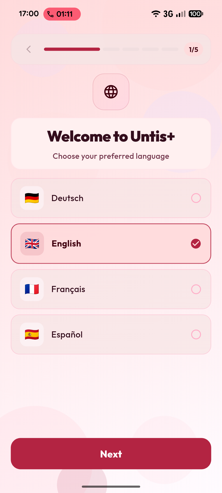
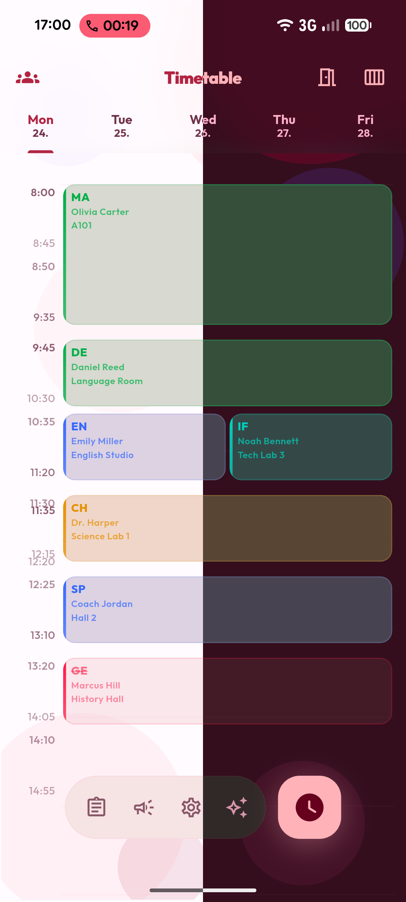
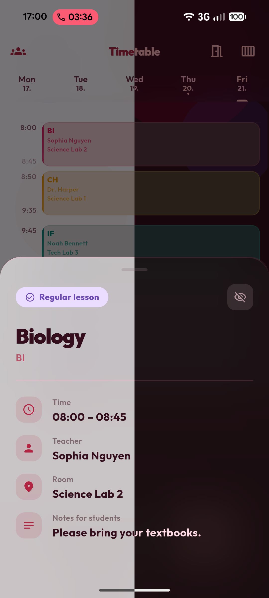
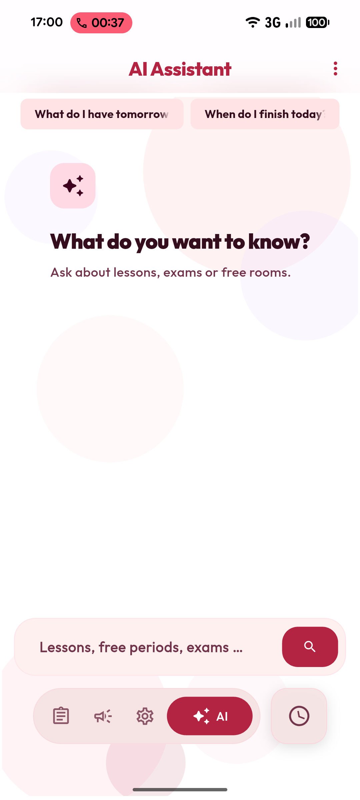
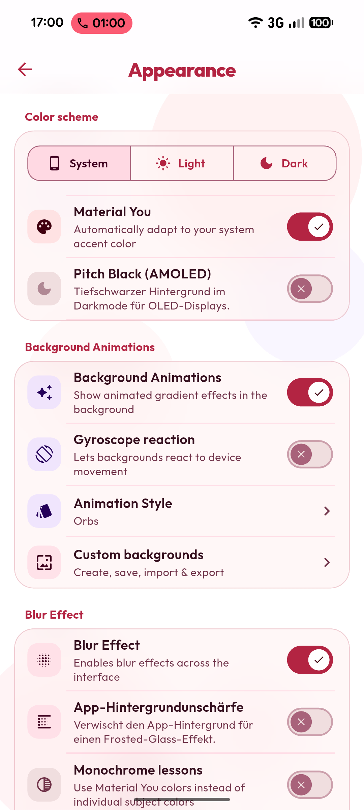
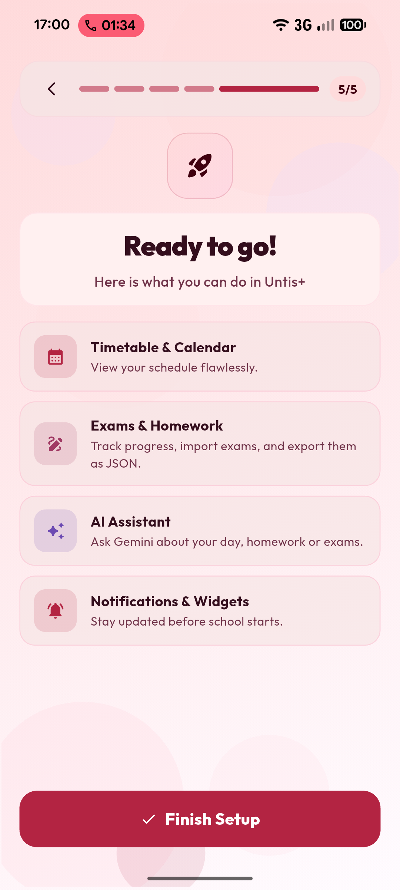

<div align="center">
  

  # UntisPlus

  **A modern, private-by-default WebUntis companion for everyday school life.**

  <p>
    <a href="https://github.com/ninocss/UntisPlus/releases"></a>
    <a href="https://github.com/ninocss/UntisPlus/stargazers"></a>
    <a href="https://github.com/ninocss/UntisPlus/network/members"></a>
    <a href="https://github.com/ninocss/UntisPlus/issues"></a>
    <a href="LICENSE"></a>
  </p>

  <p>
    <a href="https://github.com/ninocss/UntisPlus/releases">Download</a>
    &nbsp;&bull;&nbsp;
    <a href="https://github.com/ninocss/UntisPlus/issues/new/choose">Report a bug</a>
    &nbsp;&bull;&nbsp;
    <a href="https://github.com/ninocss/UntisPlus/discussions">Discussions</a>
    &nbsp;&bull;&nbsp;
    <a href="https://github.com/ninocss/UntisPlus#contributing">Contribute</a>
  </p>
</div>

<br>

## Overview

UntisPlus is an open-source Flutter client for WebUntis. It brings timetables, substitutions, homework, exams, announcements, widgets, and helpful school tools into one focused app for Android and iOS.

The app is **private by default**: credentials, schedules, and local caches are stored on your device. Optional remote AI providers only receive data when you explicitly configure and use them; local AI models keep processing on-device.

| | |
|---|---|
| **Platforms** | Android & iOS |
| **Languages** | English, German, Spanish, French |
| **Latest release** | [v5.7.1](https://github.com/ninocss/UntisPlus/releases/tag/v5.7.1) |
| **License** | [MIT](LICENSE) |

## What you can do

- **See your day at a glance** — expressive daily and weekly timetable views, lesson details, progress indicators, and gesture navigation.
- **Stay ahead of changes** — substitutions, cancellations, room changes, teacher changes, and absences in one place.
- **Track schoolwork** — homework, exams, grades, notes, and school announcements without switching apps.
- **Find free rooms and teachers** — search availability by room, teacher, or period.
- **Use AI on your terms** — run supported local GGUF models on-device or connect a provider you choose, including OpenAI-compatible endpoints, Gemini, Claude, Ollama, and DeepSeek.
- **Manage multiple accounts** — keep student and teacher profiles separated with account-scoped data and settings.
- **Personalize everything** — Material You colors, dark and AMOLED themes, custom backgrounds, and multiple visual styles.
- **Stay informed** — notifications, alarms, background updates, live activities, and customizable Android/iOS home widgets.

## Screenshots

<div align="center">
  <table>
    <tr>
      <td align="center"></td>
      <td align="center"></td>
      <td align="center"></td>
    </tr>
    <tr>
      <td align="center"><sub>Welcome</sub></td>
      <td align="center"><sub>Timetable</sub></td>
      <td align="center"><sub>Lesson details</sub></td>
    </tr>
    <tr>
      <td align="center"></td>
      <td align="center"></td>
      <td align="center"></td>
    </tr>
    <tr>
      <td align="center"><sub>AI assistant</sub></td>
      <td align="center"><sub>Appearance</sub></td>
      <td align="center"><sub>Ready to go</sub></td>
    </tr>
  </table>
</div>

## Install

### Android

Download the latest APK from [GitHub Releases](https://github.com/ninocss/UntisPlus/releases), then open it on your Android device.

### iOS with AltStore

1. Install [AltStore Classic](https://faq.altstore.io/altstore-classic) using AltServer, or use [AltStore PAL](https://faq.altstore.io/altstore-pal) in the EU.
2. Add the UntisPlus source:

   ```text
   https://raw.githubusercontent.com/ninocss/untisplus/main/altstore/source.json
   ```

3. Install UntisPlus and sign it with your Apple ID.

<div align="center">
  <a href="https://altstore.io/source/raw.githubusercontent.com/ninocss/untisplus/main/altstore/source.json?app=com.ninocss.untisplus">
    
  </a>
</div>

> **TrollStore:** A legacy TrollStore IPA is available from [Releases](https://github.com/ninocss/UntisPlus/releases). This method is not maintained for modern iOS versions and depends on device-specific CoreTrust compatibility.

## Build from source

### Requirements

- Flutter SDK `3.11` or newer
- A configured Android Studio/Xcode toolchain for your target platform
- A WebUntis account and school server for normal app use

```bash
git clone https://github.com/ninocss/UntisPlus.git
cd UntisPlus
flutter pub get
flutter run
```

Run the test suite without compiling the optional local AI runtime:

```powershell
pwsh -File tool/test_without_local_ai.ps1
```

The project is organized by feature under `lib/features`, with shared application code in `lib/core`, platform screens in `lib/screens`, and background/native integrations in `lib/services` and the platform folders.

## Project status

| Area | Status |
|---|:---:|
| Material 3 Expressive interface | ✅ |
| Offline-first cache and account isolation | ✅ |
| Local AI copilot foundation | ✅ |
| Timetable changes, absences, exams, and homework | ✅ |
| Android and iOS widgets | ✅ |
| English, German, Spanish, and French localization | ✅ |
| Broader Riverpod migration | 🚧 |

See the [issue tracker](https://github.com/ninocss/UntisPlus/issues) for planned work and the [releases page](https://github.com/ninocss/UntisPlus/releases) for recent changes.

## Star history

<div align="center">
  <a href="https://star-history.com/#ninocss/UntisPlus&Date">
    
  </a>
</div>

If UntisPlus helps you stay organized, starring the repository is the easiest way to support the project.

## Contributing

Contributions, translations, bug reports, and feature ideas are welcome.

1. Fork the repository and create a feature branch.
2. Make your change and run the relevant tests.
3. Open a pull request against `main` with a clear description.

Please use the [issue templates](https://github.com/ninocss/UntisPlus/issues/new/choose) for bug reports and feature requests. For security concerns, see [SECURITY.md](SECURITY.md).

## Support the project

If you find UntisPlus useful, you can [sponsor the project on GitHub](https://github.com/sponsors/ninocss) or support [@nino161er on Ko-fi](https://ko-fi.com/nino161er).

## Disclaimer

UntisPlus is an independent open-source project. It is not affiliated with, authorized by, endorsed by, or officially connected to WebUntis or any of its subsidiaries or affiliates.

## Developers

- [ninocss](https://github.com/ninocss) — Founder & developer
- [OseMine](https://github.com/OseMine) — Developer
